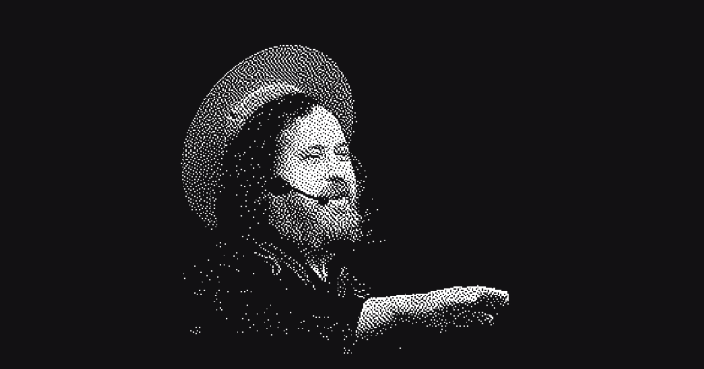

Last month I fell into quite a rabbit hole, something I seem to do often. This time it had quite an impact on me, my philosophy of software, and the importance it has in our day-to-day lives. This rabbit hole was Emacs. If you're not familiar, Emacs is a program that could be called a text editor but the informed know that's a lie. It can do just about anything you need from a computer, such as note taking, project planning, calendar, chat, RSS, web browsing, even email. I was mesmerized and spent a fair amount of time configuring it and learning more about it. What really blew my mind is that the program is over 40 years old, originally written by Richard Stallman. That was a name I had heard before but shamefully didn't know much about. Soon I learned about the free software movement, and I don't think I'll ever look at software the same. 

## What is Free Software

To answer the question of what I mean by free software, I would highly recommend watching Richard Stallman's TED Talk [here](https://youtu.be/Ag1AKIl_2GM) from 2014, but I'll try to summarize some of the main points here. 

- Computers are universal machines that take instructions and do them. While we might think that we tell the computers what to do, it really depends on the software.
- According to Stallman, either users control the software, or software controls the users. He saw this back in the 80s, and started the Free Software movement. 
- When we say "free software" we mean free as in freedom, not beer. 
- Stallman says there are four essential freedoms. If all are present, the user controls the program. If just one is missing, the program controls the user. 
  - Freedom 0: Run the program as you wish for whatever purpose.
  - Freedom 1: Change the software as needed using the source code.
  - Freedom 2: Redistribute the software.
  - Freedom 3: Redistribute the software with changes.

While most of this might sound extreme, Stallman makes some good points as to why it matters. The dangers of proprietary software are things almost all of us have experienced. One of them is restricting users from what they want to do. This is actually how Stallman started his journey, when he wanted to fix a bug in copier software at MIT but the manufacturer wouldn't share the source code. More recently the dangers have been spying on users and tracking them, deleting content without consent, or adding backdoor access for governments. All of these points make a compelling argument for free software, but it does come at a price (which even Stallman acknowledges in his talk). 

## The Catch

If you ever try to embrace the free software movement, you will quickly feel the cost of convenience. During my Emacs rabbit hole I also fell into Guix Linux. This is a package manager and distro built by the free software movement. It's similar to Nix in how it's declarative; however, the upstream repos don't allow any proprietary software whatsoever. This was actually a selling point for me; I thought it was a cool feature. However during my install on my desktop machine, I found out that several of my drivers were proprietary. Some of these drivers had been reverse engineered, but not that many. That meant losing access to some of my machine features like the GPU and Wi-Fi access. When talking to others using Guix, many of them acknowledged this limitation and just used a different upstream repo for getting the proprietary software they needed. I ended up doing the same, but by doing so it kinda went against the whole point of the project.

Stallman's convictions go even further. He's a staunch believer that people shouldn't have cellphones as they're basically tracking devices with loads of proprietary software. While this is true, I think it's bordering on territory too extreme for the average person. Phones have become an essential form of communication and means of existing in our society; it's just not that simple to stop using them altogether.

The whole ordeal reminded me of an episode of Parks and Recreation where the character Ron Swanson, a stern libertarian and privacy advocate, found out that his address had been given to a company for mailing adverts. He was appalled and spent the day going off-grid, shredding any public evidence of his existence. Near the end of the episode he was trying to buy a camper using gold (that he keeps buried in undisclosed locations), when he was confronted by his wife. She had a flat tire and had been trying to contact him all day. While Ron did not have to be on the grid, he had to be on his family's grid.

Similarly with free software, I've come to the conclusion that we need balance and nuance. Richard Stallman has spent his life trying to convince everyday people why free software matters. He wants people to be aware and to take action so they're not taken advantage of. The challenge is that normal people don't care about any of this. Trying to get them to use something like Guix or get rid of their cellphone is going to be close to impossible. Technology can improve and maybe it will get to a place where it can be used by anyone, but it's nowhere close. Instead we should be convincing people to start small, by trying free software alternatives to applications they use every day. If they're bold, perhaps getting them on Linux. The key for progress is that we who are more technical need to help them. We need to be welcoming, helpful, and kind. Gatekeeping is loser behavior that doesn't help anyone.

## Moving Forward

Needless to say this experience had quite an impact on me and how I approach software. In light of my convictions, I've taken the following actions:

- AI: While I'm not completely anti-AI yet, I did cancel my Anthropic subscription a while back and have stuck with only open source models since then. 
- OS: I'm moving to using Linux full-time for my personal machines, sticking with my personal favorite setup of Alpine Linux + XFCE. 
- Machine: With the move to Linux I am moving over to a ThinkPad T14 and [selling my M4 MacBook Pro](https://stevedylan.dev/now/selling-my-macbook). 
- Community: I want to help more people use Linux, so I might look into hosting a local Linux class or debugging sessions.

The reality is that free software is a journey. Nobody just arrives immediately and becomes a holy saint in a day. I don't have all of this figured out or know how I'll achieve free software in some contexts, but I'm going to try. The pursuit of freedom takes time, and that's okay.
